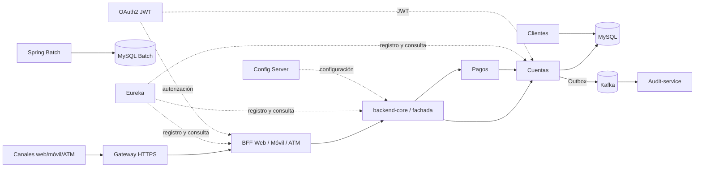

# Arquitectura de servicios

La base `bancoxyz_operacional` contiene las cuentas y la auditoría de movimientos; la base `bancoxyz_batch` contiene los resultados del procesamiento CSV. La integración es por HTTP entre dominios y por Kafka hacia auditoría. Las entradas de cliente están cifradas por el gateway HTTPS; el tráfico interno es HTTP dentro de la red privada de Docker y requiere medidas adicionales en un entorno de producción.

## Procesos de modernización y justificación

Los tres CSV oficiales de `batch-service` alimentan los Jobs y sus tablas de resultados. Los tres CSV de `backend-core` conservan los datos de demostración de la entrega anterior: el resumen mostrado por el BFF Web se calcula con `backend-core/.../data/semana_3/transacciones.csv`, no con la tabla Batch `resumen_transacciones`. Por ello, sus conteos y totales no deben utilizarse para conciliar el lote oficial. Las cuentas y operaciones del entorno Compose se consultan mediante los servicios de dominio y MySQL.

La propuesta aborda cinco procesos: **migración batch**, **separación del monolito en microservicios**, **BFF por canal**, **seguridad distribuida** y **mensajería asíncrona con Kafka**.

| Necesidad del banco | Decisión técnica | Resultado verificable |
|---|---|---|
| Reducir el acoplamiento entre canales y operaciones bancarias | Tres BFF independientes y servicios de Cuentas, Pagos y Clientes | Respuestas especializadas y permisos diferenciados (`401`, `403`, `200`) |
| Mantener consistencia y trazabilidad de depósitos, retiros y transferencias | MySQL con transacciones, bloqueo de filas, outbox y consumidor Kafka | Saldos persistentes, operaciones atómicas y eventos auditados |
| Modernizar el procesamiento legacy y permitir crecimiento gradual | Tres Jobs Spring Batch, chunks/particiones, Config Server y Eureka | Procesamiento de CSV oficiales, reintentos y descubrimiento de servicios |

### Límites del entorno de referencia

El gateway del laboratorio expone TLS con certificados internos. El tráfico entre contenedores no está cifrado y la publicación de HTTP se limita a la interfaz loopback para pruebas. En AWS se deben definir DNS, certificados confiables, aislamiento de red y gestión de secretos. Para demostrar escalado real es necesario ejecutar instancias adicionales de los tres servicios de dominio y verificar la distribución de solicitudes; la configuración local de puertos fijos no debe presentarse como prueba de escalabilidad por sí sola.
